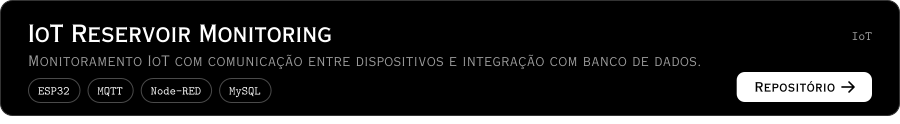
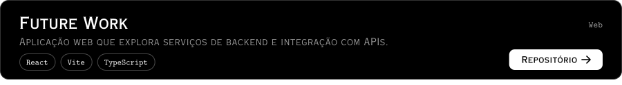

<picture><source media="(prefers-color-scheme: dark)" srcset="assets-copperplate/header-dark.svg"><source media="(prefers-color-scheme: light)" srcset="assets-copperplate/header-light.svg"></picture>

<a href="#projetos">Projetos</a> &nbsp;·&nbsp; <a href="#stack">Stack</a> &nbsp;·&nbsp; <a href="#contato">Contato</a>

Desenvolvo sistemas backend, APIs REST, bancos de dados, cloud e IoT. 
Análise e Desenvolvimento de Sistemas na FIAP, formatura prevista para dez/2026.

 

## Projetos

<a href="https://github.com/Group-GS/Gs-Java"><picture><source media="(prefers-color-scheme: dark)" srcset="assets-copperplate/cards/projeto-agro-dark.svg"><source media="(prefers-color-scheme: light)" srcset="assets-copperplate/cards/projeto-agro-light.svg"></picture></a> 
<a href="https://github.com/Challenge-CLYVO/Database-Challenge"><picture><source media="(prefers-color-scheme: dark)" srcset="assets-copperplate/cards/clyvo-vet-dark.svg"><source media="(prefers-color-scheme: light)" srcset="assets-copperplate/cards/clyvo-vet-light.svg"></picture></a> 
<a href="https://github.com/samyrcouto/IOT-Sistema-Reservatorio"><picture><source media="(prefers-color-scheme: dark)" srcset="assets-copperplate/cards/iot-reservoir-monitoring-dark.svg"><source media="(prefers-color-scheme: light)" srcset="assets-copperplate/cards/iot-reservoir-monitoring-light.svg"></picture></a> 
<a href="https://github.com/samyrcouto/Future-Work"><picture><source media="(prefers-color-scheme: dark)" srcset="assets-copperplate/cards/future-work-dark.svg"><source media="(prefers-color-scheme: light)" srcset="assets-copperplate/cards/future-work-light.svg"></picture></a>

 

## Stack

- **Backend** <code>Java</code> <code>Spring Boot</code> <code>APIs REST</code>
- **Bancos de dados** <code>Oracle</code> <code>SQL</code> <code>PL/SQL</code> <code>MySQL</code>
- **Frontend** <code>JavaScript</code> <code>TypeScript</code> <code>React</code>
- **Cloud e DevOps** <code>Azure</code> <code>Docker</code> <code>Git</code> <code>Azure DevOps</code>
- **IoT** <code>ESP32</code> <code>MQTT</code> <code>Node-RED</code>

 

## Contato

<a href="https://www.linkedin.com/in/samyr-couto-12932834b/"><picture><source media="(prefers-color-scheme: dark)" srcset="assets-copperplate/buttons/linkedin-dark.svg"><source media="(prefers-color-scheme: light)" srcset="assets-copperplate/buttons/linkedin-light.svg"></picture></a>
<a href="mailto:ssmyrcouto@gmail.com"><picture><source media="(prefers-color-scheme: dark)" srcset="assets-copperplate/buttons/email-dark.svg"><source media="(prefers-color-scheme: light)" srcset="assets-copperplate/buttons/email-light.svg"></picture></a>

