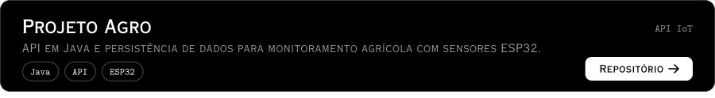
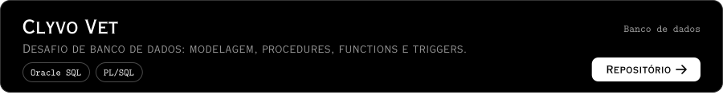
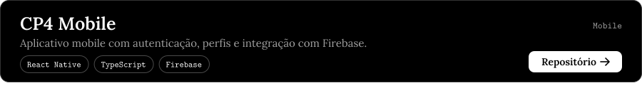

<picture><source media="(prefers-color-scheme: dark)" srcset="assets/header-dark.svg"><source media="(prefers-color-scheme: light)" srcset="assets/header-light.svg"></picture>

<a href="#projetos"><picture><source media="(prefers-color-scheme: dark)" srcset="assets/buttons/projetos-dark.svg"><source media="(prefers-color-scheme: light)" srcset="assets/buttons/projetos-light.svg"></picture></a>
<a href="#stack"><picture><source media="(prefers-color-scheme: dark)" srcset="assets/buttons/stack-dark.svg"><source media="(prefers-color-scheme: light)" srcset="assets/buttons/stack-light.svg"></picture></a>
<a href="#contato"><picture><source media="(prefers-color-scheme: dark)" srcset="assets/buttons/contato-dark.svg"><source media="(prefers-color-scheme: light)" srcset="assets/buttons/contato-light.svg"></picture></a>

Desenvolvo sistemas backend, APIs REST, bancos de dados, cloud e IoT. 
**Formação:** Análise e Desenvolvimento de Sistemas, FIAP (formatura prevista: dez/2026)

## Projetos

<a href="https://github.com/Group-GS/Gs-Java"><picture><source media="(prefers-color-scheme: dark)" srcset="assets/cards/projeto-agro-dark.svg"><source media="(prefers-color-scheme: light)" srcset="assets/cards/projeto-agro-light.svg"></picture></a> 
<a href="https://github.com/Challenge-CLYVO/Database-Challenge"><picture><source media="(prefers-color-scheme: dark)" srcset="assets/cards/clyvo-vet-dark.svg"><source media="(prefers-color-scheme: light)" srcset="assets/cards/clyvo-vet-light.svg"></picture></a> 
<a href="https://github.com/samyrcouto/dimdim-music-devops5"><picture><source media="(prefers-color-scheme: dark)" srcset="assets/cards/dimdim-music-dark.svg"><source media="(prefers-color-scheme: light)" srcset="assets/cards/dimdim-music-light.svg"></picture></a> 
<a href="https://github.com/samyrcouto/IOT-Sistema-Reservatorio"><picture><source media="(prefers-color-scheme: dark)" srcset="assets/cards/iot-reservoir-monitoring-dark.svg"><source media="(prefers-color-scheme: light)" srcset="assets/cards/iot-reservoir-monitoring-light.svg"></picture></a> 
<a href="https://github.com/samyrcouto/cp4-mobile"><picture><source media="(prefers-color-scheme: dark)" srcset="assets/cards/cp4-mobile-dark.svg"><source media="(prefers-color-scheme: light)" srcset="assets/cards/cp4-mobile-light.svg"></picture></a> 
<a href="https://github.com/samyrcouto/Future-Work"><picture><source media="(prefers-color-scheme: dark)" srcset="assets/cards/future-work-dark.svg"><source media="(prefers-color-scheme: light)" srcset="assets/cards/future-work-light.svg"></picture></a>

## Stack

| Área | Ferramentas |
| :-- | :-- |
| Backend | <code>Java</code> <code>Spring Boot</code> <code>APIs REST</code> |
| Bancos de dados | <code>Oracle</code> <code>SQL</code> <code>PL/SQL</code> <code>MySQL</code> |
| Frontend | <code>JavaScript</code> <code>TypeScript</code> <code>React</code> |
| Cloud e DevOps | <code>Azure</code> <code>Docker</code> <code>Git</code> <code>Azure DevOps</code> |
| IoT | <code>ESP32</code> <code>MQTT</code> <code>Node-RED</code> |

## Contato

<a href="https://www.linkedin.com/in/samyr-couto-12932834b/"><picture><source media="(prefers-color-scheme: dark)" srcset="assets/buttons/linkedin-dark.svg"><source media="(prefers-color-scheme: light)" srcset="assets/buttons/linkedin-light.svg"></picture></a>
<a href="mailto:ssmyrcouto@gmail.com"><picture><source media="(prefers-color-scheme: dark)" srcset="assets/buttons/email-dark.svg"><source media="(prefers-color-scheme: light)" srcset="assets/buttons/email-light.svg"></picture></a>

<a href="#">Voltar ao topo</a>
