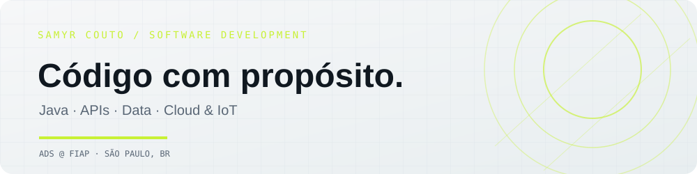
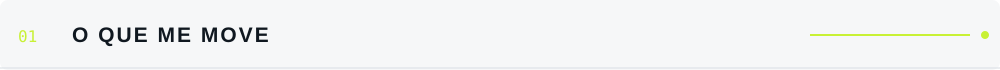
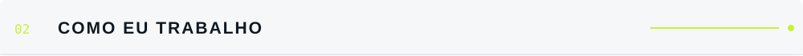
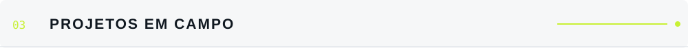
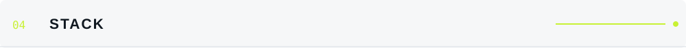
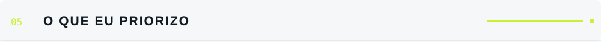
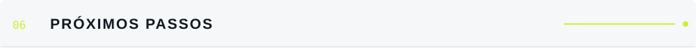
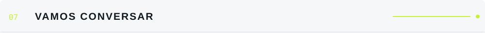

<!-- Perfil pessoal inspirado em layout editorial com assets responsivos a tema claro/escuro -->

<picture>
  <source media="(prefers-color-scheme: dark)" srcset="assets/header-dark.svg">
  
</picture>

<p align="left">
  <a href="https://www.linkedin.com/in/samyr-couto-12932834b/"></a>
  <a href="mailto:ssmyrcouto@gmail.com"></a>
  <a href="https://github.com/samyrcouto"></a>
  
</p>

<br>

<picture>
  <source media="(prefers-color-scheme: dark)" srcset="assets/01-problem-dark.svg">
  
</picture>

Eu gosto de entender como as partes de um sistema se conectam: **a regra de negócio, a API, o banco de dados e quem usa a solução**. Estudo Análise e Desenvolvimento de Sistemas na FIAP e venho construindo essa base por meio de projetos acadêmicos e trabalho em equipe.

Meu foco hoje está em **backend com Java, APIs REST e bancos de dados**, explorando também cloud, containers e integração com IoT.

<br>

<picture>
  <source media="(prefers-color-scheme: dark)" srcset="assets/02-principles-dark.svg">
  
</picture>

<table>
  <tr>
    <td width="50%" valign="top"><code>[1]</code> <b>Entender antes de implementar.</b><br><sub>Começo pelo problema e pelas regras que a solução precisa atender.</sub></td>
    <td width="50%" valign="top"><code>[2]</code> <b>Dados bem pensados ajudam o sistema inteiro.</b><br><sub>Dou atenção à modelagem, às relações e à consistência do banco.</sub></td>
  </tr>
  <tr>
    <td width="50%" valign="top"><code>[3]</code> <b>Construir em equipe.</b><br><sub>Colaboro na implementação e na organização das entregas, sem perder de vista o objetivo comum.</sub></td>
    <td width="50%" valign="top"><code>[4]</code> <b>Aprender fazendo.</b><br><sub>Testo, corrijo e procuro entender por que uma solução funciona — ou não.</sub></td>
  </tr>
</table>

<br>

<picture>
  <source media="(prefers-color-scheme: dark)" srcset="assets/03-shipped-dark.svg">
  
</picture>

<table>
  <tr>
    <td width="50%" valign="top">
      <h3><a href="https://github.com/Group-GS/Gs-Java">Projeto Agro</a></h3>
      API Java e persistência de dados em uma solução de monitoramento agrícola integrada a sensores ESP32.
      <br><br><sub><b>FOCO</b> · Contribuição no desenvolvimento da API, banco de dados e integração entre componentes.</sub>
      <br><br><code>Java</code> <code>Spring Boot</code> <code>Oracle SQL</code> <code>ESP32</code>
    </td>
    <td width="50%" valign="top">
      <h3><a href="https://github.com/Challenge-CLYVO/Database-Challenge">Clyvo Vet · Database Challenge</a></h3>
      Projeto de banco de dados com modelagem e implementação de objetos e rotinas para apoiar regras de negócio.
      <br><br><sub><b>FOCO</b> · SQL, PL/SQL, procedures, functions, packages, triggers e tratamento de erros.</sub>
      <br><br><code>Oracle</code> <code>SQL</code> <code>PL/SQL</code> <code>Docker</code>
    </td>
  </tr>
  <tr>
    <td width="50%" valign="top">
      <h3><a href="https://github.com/samyrcouto/dimdim-music-devops5">Dimdim Music · DevOps</a></h3>
      API REST para catálogo musical, com documentação da API e práticas relacionadas ao ecossistema Azure.
      <br><br><sub><b>FOCO</b> · Desenvolvimento backend e documentação técnica.</sub>
      <br><br><code>Java</code> <code>Spring Boot</code> <code>Swagger</code> <code>Azure</code>
    </td>
    <td width="50%" valign="top">
      <h3><a href="https://github.com/samyrcouto/IOT-Sistema-Reservatorio">Sistema de Reservatório · IoT</a></h3>
      Projeto de monitoramento usando microcontrolador, mensageria e armazenamento de dados.
      <br><br><sub><b>FOCO</b> · Comunicação entre ESP32, MQTT, Node-RED e banco de dados.</sub>
      <br><br><code>ESP32</code> <code>MQTT</code> <code>Node-RED</code> <code>MySQL</code>
    </td>
  </tr>
  <tr>
    <td width="50%" valign="top">
      <h3><a href="https://github.com/samyrcouto/cp4-mobile">CP4 Mobile</a></h3>
      Aplicação mobile com fluxo de autenticação, perfil e integração com serviços Firebase.
      <br><br><code>React Native</code> <code>Expo</code> <code>TypeScript</code> <code>Firestore</code>
    </td>
    <td width="50%" valign="top">
      <h3><a href="https://github.com/samyrcouto/Future-Work">Future Work</a></h3>
      Aplicação web desenvolvida com React e TypeScript, explorando integração com serviços backend.
      <br><br><code>React</code> <code>Vite</code> <code>TypeScript</code> <code>REST API</code>
    </td>
  </tr>
</table>

<br>

<picture>
  <source media="(prefers-color-scheme: dark)" srcset="assets/04-scope-dark.svg">
  
</picture>

<p></p>

```text
backend       Java · Spring Boot · Spring Data JPA · APIs REST
bancos        Oracle · SQL · PL/SQL · MySQL · SQL Server / Azure SQL
frontend      JavaScript · TypeScript · React · HTML · CSS · Vite
cloud/devops  Microsoft Azure · Docker · Docker Compose · Git · Azure DevOps
api tools     Swagger / OpenAPI · Postman
IoT           ESP32 · MQTT · Node-RED · Arduino
```

<br>

<picture>
  <source media="(prefers-color-scheme: dark)" srcset="assets/05-non-goals-dark.svg">
  
</picture>

```diff
- adicionar tecnologia só para encher a lista
- esconder decisões importantes atrás de código complicado
- afirmar experiência que ainda estou construindo
+ resolver o problema com clareza
+ aprender com feedback e colaboração
+ documentar o que ajuda outra pessoa a continuar
```

<br>

<picture>
  <source media="(prefers-color-scheme: dark)" srcset="assets/06-roadmap-dark.svg">
  
</picture>

- [x] Construir projetos acadêmicos com Java, SQL e APIs
- [x] Explorar integração entre backend, dados e IoT
- [ ] Aprofundar arquitetura de APIs e testes automatizados
- [ ] Evoluir em cloud, Docker e práticas de CI/CD
- [ ] Concluir ADS na FIAP — previsão: dezembro de 2026

<br>

<picture>
  <source media="(prefers-color-scheme: dark)" srcset="assets/07-see-also-dark.svg">
  
</picture>

Estou buscando uma oportunidade de **estágio em desenvolvimento de software**, especialmente em backend, APIs e bancos de dados. Se quiser trocar uma ideia sobre projetos ou tecnologia, me chama pelo [LinkedIn](https://www.linkedin.com/in/samyr-couto-12932834b/) ou [e-mail](mailto:ssmyrcouto@gmail.com).

<picture>
  <source media="(prefers-color-scheme: dark)" srcset="assets/footer-dark.svg">
  
</picture>
